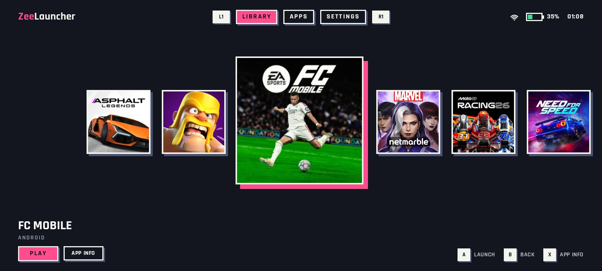

  
 
                   

# ZeeLauncher

A console-style game launcher for Android, built for gamepads and touch. Your games sit in a big carousel, every screen works with a controller, and the whole interface is made for landscape. Set it as your home screen and your device boots straight into your games, just like a console.
